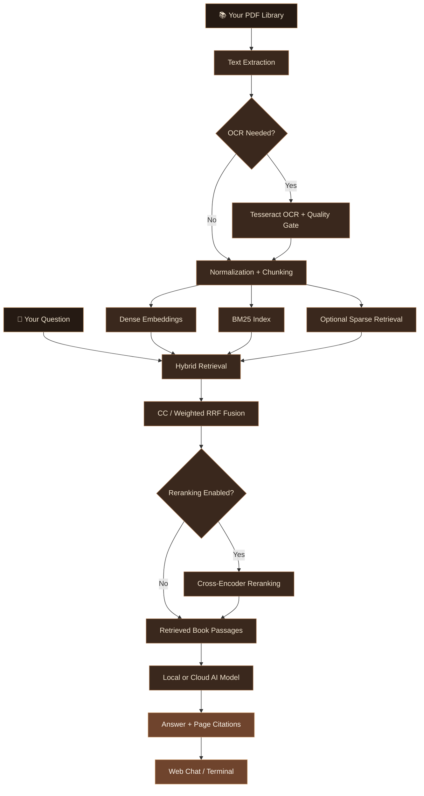

<div align="center">


<br/>

<a href="docs/dev-notes.md">

</a>

<br/><br/>

<a href="docs/dev-notes.md"><strong>📖 برای مطالعهٔ نسخهٔ فارسی اینجا کلیک کنید</strong></a>

<br/><br/>


<br/>

<a href="https://www.python.org/">

</a>
<a href="https://github.com/Amin-Moniry/bookly">

</a>
<a href="LICENSE">

</a>


<br/><br/>

**A quieter place for your books. A clearer path to their answers.**

Chat with your own PDF books in **English** and **Persian**.<br/>
Search their pages, follow the citations, and keep control of your library.

<br/>

[Getting Started](#-getting-started) ·
[Features](#-key-features) ·
[AI Models](#-connect-your-ai-model) ·
[Privacy](#-privacy--data-boundaries) ·
[راهنمای فارسی](docs/dev-notes.md)

</div>

---

<div align="center">

## ◈ Overview

**Bookly** is a local, self-hosted **Retrieval-Augmented Generation (RAG)** assistant for your own PDF books.

It extracts text, applies OCR when needed, builds a hybrid search index, and retrieves relevant passages to help an AI model answer your questions with **page-level source references**.

**Your library and retrieval pipeline stay local.**<br/>
Choose a **local model** for on-device inference, or connect a **cloud model** through an OpenAI-compatible API.

</div>

<br/>

> **Built to answer from your books—not to replace them.**
>
> Bookly is designed to ground answers in retrieved passages and acknowledge missing information. As with any AI assistant, verify important claims against the cited pages.

---

<div align="center">

## ◈ Why Bookly?

*From a folder of PDFs to a library you can question.*

</div>

| The friction | The Bookly approach |
|:---|:---|
| You remember an idea, but not its location | Search by meaning and keywords |
| A scanned book has no selectable text | OCR fallback with a scanned-page quality gate |
| Persian text contains inconsistent characters | Arabic-letter and ZWNJ normalization with Persian-aware tokenization |
| An answer is difficult to verify | Numbered sources with page references |
| You want to choose your model | A built-in panel for local and cloud endpoints |
| Your library changes over time | Incremental sync processes new, changed, and removed books |

<br/>

<div align="center">

### Three Pillars

<table>
<tr>
<td align="center" width="270">

<h3>◆ Your Library</h3>

Local PDF storage, text extraction, optional OCR, and incremental indexing.

</td>
<td align="center" width="270">

<h3>◆ Hybrid Search</h3>

Dense embeddings, BM25, and optional sparse retrieval—combined through configurable fusion.

</td>
<td align="center" width="270">

<h3>◆ Traceable Answers</h3>

Streaming chat with numbered citations and links back to source pages.

</td>
</tr>
</table>

</div>

---

<div align="center">

## ◈ Key Features


</div>

| Feature | Details |
|:---|:---|
| **Bilingual web interface** | English / فارسی, dark and light themes, chat history, and streaming answers |
| **Hybrid retrieval** | Dense embeddings ⨁ BM25 ⨁ optional sparse retrieval |
| **Configurable fusion** | Convex Combination (`cc`) or weighted Reciprocal Rank Fusion (`rrf`) |
| **Page-level citations** | Numbered references such as `[1]` with source-book and page information |
| **Built-in model panel** | Add and activate OpenAI-compatible models without editing application code |
| **Local or cloud inference** | Ollama, LM Studio, vLLM, OpenAI, OpenRouter, and compatible endpoints |
| **Persian-aware processing** | ZWNJ handling, Arabic-letter normalization, and a Persian BM25 tokenizer |
| **Scanned-PDF support** | Tesseract OCR fallback with a quality gate |
| **Incremental indexing** | Detect added, renamed, edited, and removed books |
| **Resumable M3 indexing** | Built-in checkpointing for the `m3` embedding backend |
| **Optional reranking** | Cross-encoder reranker; disabled by default, GPU recommended |
| **Ready-made demo** | A small sample book and keyword index for trying the UI before indexing |
| **Terminal interface** | One-shot questions and an interactive REPL using the same engine |

---

<div align="center">

## ◈ System Architecture

*From PDF pages to cited answers.*

</div>



---

<div align="center">

## ◈ A Look Inside

### Your books, in conversation

</div>


<br/>

<div align="center">

### Your model, your choice


</div>

---

<div align="center">

## ◈ Indexing Time

*Practical estimates—not a fixed benchmark.*

</div>

Approximate first-index times for a **single ~300-page PDF on a typical laptop CPU, without a GPU**:

| Mode | Mostly text PDF | Scanned PDF requiring OCR |
|:---|:---:|:---:|
| **`backend = "st"` — default** | ~5–15 minutes | ~15–45 minutes |
| **`backend = "m3"` — higher-quality option** | ~1–3 hours | ~3–6 hours |
| **Re-sync an unchanged library** | Usually seconds | Usually seconds |

> Actual time depends on your CPU, book length, scan quality, model availability, and configuration. Changed books still require processing.

- **Text extraction:** approximately 1 ms/page for plain-text PDFs.
- **OCR:** approximately 1–3 seconds/page; often the main bottleneck for scanned books.
- **Keyword-only start:** `--no-embed` can produce a text-only index in under a minute for suitable inputs.
- **M3 checkpointing:** interrupted indexing can resume on the next `sync`.
- **Start small:** index one book first, then expand your library.

---

<div align="center">

## ◈ Getting Started


</div>

### 01 · Prerequisites

- **Python 3.11+** — the project uses standard-library `tomllib`.
- **Your PDF books** — text-based or scanned, Persian or English.
- **Tesseract OCR** — only needed for scanned PDFs.
- **An AI endpoint** — local or cloud, when you want generated chat answers.

For OCR:

- Windows users can install Tesseract using the [UB Mannheim builds](https://github.com/UB-Mannheim/tesseract/wiki).
- Configure the executable path in `booksearch.toml` if necessary.
- Download `fas.traineddata` and `eng.traineddata` from [tessdata_best](https://github.com/tesseract-ocr/tessdata_best) and place them in `app/tessdata/`.

### 02 · Clone & Install

```bash
git clone https://github.com/Amin-Moniry/bookly.git
cd bookly
python -m venv .venv
```

**Windows — PowerShell**

```powershell
.\.venv\Scripts\Activate.ps1
python -m pip install -r requirements.txt
```

**Linux / macOS**

```bash
source .venv/bin/activate
python -m pip install -r requirements.txt
```

> The commands below assume the virtual environment is active.

### 03 · Add Your Books

Place your PDFs in `library/`:

```text
library/
├── poetry-collection.pdf
├── ai-handbook.pdf
└── my-notes/
    └── another-book.pdf
```

Use any filenames or subfolders, in Persian or English. Bookly detects library changes during sync.

### 04 · Build the Index

```bash
python app/ingest.py sync
```

The pipeline processes your books through:

```text
extract → OCR if needed → chunk → embed → merge
```

**Want to try search sooner?**

```bash
python app/ingest.py sync --no-embed
```

This builds a keyword-search-capable index without embeddings. Add the semantic layer later:

```bash
python app/ingest.py sync --force embed
```

### 05 · Launch Bookly

```bash
python app/server.py
```

Open **http://127.0.0.1:8765**.

> **No indexed books yet?**
>
> Bookly includes `demo/sample-book.pdf` and a ready-made keyword index in `index/sample/`. The app uses this demo until your first real library sync, then switches to your own books.

### 06 · Connect a Model & Ask

Use the **✨ AI models** button in the header, add an endpoint, and click the model to activate it.

Try a question:

> خلاصهٔ فصل سوم چیه؟

Or:

> What does this book say about the main causes of this problem?

Bookly is designed to retrieve relevant passages, cite their pages, and indicate when the requested information is not found.

### Keep Your Library Updated

Run this whenever you add, edit, rename, or remove books:

```bash
python app/ingest.py sync
```

Unchanged books are skipped.

---

<div align="center">

## ◈ Connect Your AI Model

*One panel. Local and cloud options.*

</div>

Open **http://127.0.0.1:8765** → **✨ AI models**.

| Field | Local examples | Cloud examples |
|:---|:---|:---|
| **Base URL** | Ollama: `http://127.0.0.1:11434/v1`<br/>LM Studio: `http://127.0.0.1:1234/v1` | OpenAI: `https://api.openai.com/v1`<br/>Or another OpenAI-compatible endpoint |
| **API key** | Usually empty for a default local setup; endpoint-dependent | Your provider's API key |
| **Model ID** | `mistral` / `qwen2.5:7b` | For example, `gpt-4o-mini`, if available from your provider |

**Click a model to activate it.** The header chip shows the active model.

Bookly can also connect to **vLLM**, **OpenRouter**, and other OpenAI-compatible servers.

> Model IDs must match models installed locally or offered by your provider. Start your local model server before testing its connection.

---

<div align="center">

## ◈ Terminal Mode

*The same engine, without the browser.*

</div>

**Ask one question:**

```bash
python app/booker.py "یک سؤال دربارهٔ کتاب‌هات"
```

**Start an interactive session:**

```bash
python app/booker.py
```

Terminal-chat defaults are configured in the `[llm]` section of `booksearch.toml`.

---

<div align="center">

## ◈ Configuration

</div>

The main configuration lives in **[`booksearch.toml`](booksearch.toml)**, with Persian and English comments.

| Section | Controls |
|:---|:---|
| **`[paths]`** | Library and index locations |
| **`[extract]`** | OCR engine, DPI, parallel workers, and scanned-page quality gate |
| **`[chunk]`** | Chunk size, sentence overlap, and section headers |
| **`[embed]`** | `st` fast default or `m3` higher-quality embedding backend |
| **`[search]`** | Fusion mode (`cc` / `rrf`), retrieval depth, thresholds, and neighboring chunks |
| **`[rerank]`** | Optional cross-encoder reranking; disabled by default |
| **`[llm]`** | Terminal-chat model defaults |

> **Do not put real API keys in tracked configuration files.**
>
> Models added through the web panel are stored locally in `app/llm_models.json`, which is git-ignored.

---

<div align="center">

## ◈ Persian & English


</div>

Bookly supports Persian and English across its library-search workflow:

- **Bilingual interface** with English and Persian options.
- **Persian text normalization**, including Arabic-letter variants and ZWNJ handling.
- **Persian-aware BM25 tokenization** for keyword retrieval.
- **OCR support** with `fas` and `eng` Tesseract language data.
- **Persian and English filenames**, including nested library folders.

> OCR quality depends on scan quality and the installed language data. Review extracted text when a scanned book produces poor search results.

<br/>

<div align="center">

### راهنمای فارسی

برای مطالعهٔ نسخهٔ فارسی راهنما و یادداشت‌های فنی پروژه، روی دکمهٔ زیر کلیک کنید.

<a href="docs/dev-notes.md">

</a>

</div>

---

<div align="center">

## ◈ Privacy & Data Boundaries

*Local-first does not mean every model is local.*

</div>

### What Stays Local

- Your PDFs in `library/`.
- Text extraction, OCR, chunking, and the search index.
- Model-panel credentials in `app/llm_models.json`.
- Chat history in your browser's `localStorage`.

### When You Choose a Cloud Model

Requests sent to a cloud endpoint can include **your question and retrieved book passages** needed to answer it. Their handling is subject to that provider's policies.

For on-device inference, use a model server running on your own machine.

### What Is Excluded from Git

| Path | Contents |
|:---|:---|
| `library/` | Your PDF books |
| `index/` | Generated library indexes; the tracked demo index is an intentional exception |
| `app/llm_models.json` | Model-panel configuration and API keys |
| `eval/questions.jsonl` | Private evaluation questions |
| `eval/results.jsonl` | Private evaluation results |
| OCR language-data directories | Downloaded Tesseract language files |

Only an anonymized evaluation-format sample is intended to be tracked: [`eval/questions.sample.jsonl`](eval/questions.sample.jsonl).

> **Before publishing**
>
> Inspect `git status` and staged changes. Git-ignore rules do not remove files already tracked by Git. Confirm that no books, private questions, credentials, or personal indexes are included.

---

<div align="center">

## ◈ Tests

</div>

Run the test suite:

```bash
python -m pytest tests -q
```

The documented suite contains **44 tests**, covering:

| Area | Coverage |
|:---|:---|
| **Text processing** | Normalization and tokenization |
| **Retrieval** | RRF fusion |
| **Index stability** | Stable chunk IDs |
| **Incremental sync** | Add, rename, edit, and delete behavior |
| **Evaluation** | Evaluation-harness behavior |
| **CLI** | Command-line behavior |

For the Persian guide, design decisions, benchmark history, and engineering notes, see [`docs/dev-notes.md`](docs/dev-notes.md).

---

<div align="center">

## ◈ Troubleshooting

</div>

| Symptom | What to check |
|:---|:---|
| **“No answer found in the books” for every question** | Confirm `library/` contains PDFs, then run `python app/ingest.py sync` |
| **Garbage text from scanned pages** | Install Tesseract, add `fas` / `eng` traineddata to `app/tessdata/`, and check OCR configuration |
| **“Server unreachable” in chat** | Start the backend with `python app/server.py` |
| **Embeddings are slow on CPU** | Keep `backend = "st"`; reserve `m3` for quality-critical use |
| **Model connection test fails** | Use the API base URL—not a URL ending in `/chat/completions`; verify the model ID, server, and key |
| **Need a clean rebuild** | Back up anything you need, remove the generated library index, then run `sync` again |

### OCR Reminder

The default OCR engine is `tesseract`. PDFs with usable selectable text skip OCR.

### Interrupted M3 Indexing

Run the sync command again. The `m3` backend supports checkpointing so interrupted work can resume.

---

<div align="center">

## ◈ Repository Layout

</div>

```text
bookly/
├── booksearch.toml          # Main configuration
├── requirements.txt        # Python dependencies
│
├── app/                    # Server, retrieval, ingestion, CLI, evaluation
│   ├── server.py           # Web application entry point
│   ├── ingest.py           # Incremental library indexing
│   ├── booker.py           # Terminal chat
│   ├── web/
│   │   └── index.html      # Single-file frontend; no build step
│   ├── tessdata/           # Downloaded OCR language files
│   └── llm_models.json     # Local model settings + keys; git-ignored
│
├── static/                 # README screenshots
│   ├── main.png
│   └── Ai-Part.png
│
├── demo/
│   ├── sample-book.pdf     # Small demo book
│   └── make_sample_book.py # Demo-book generator
│
├── library/                # Your PDFs; git-ignored
├── index/                  # Generated library indexes
│   └── sample/             # Ready-made demo keyword index
│
├── eval/                   # Evaluation data; private files git-ignored
│   └── questions.sample.jsonl
├── tests/                  # Pytest suite
├── docs/
│   └── dev-notes.md        # Persian guide + engineering notes
│
└── LICENSE                 # MIT license
```

---

<div align="center">

## ◈ FAQ

</div>

| Question | Answer |
|:---|:---|
| **Can I use Bookly without a GPU?** | Yes. The default `st` embedding backend is the faster CPU-oriented starting point. Local chat-model requirements depend on the model you choose. |
| **Do I need a cloud API?** | No. You can use a local OpenAI-compatible model server. |
| **Can I start without embeddings?** | Yes. Use `sync --no-embed` for a keyword-search-capable index. |
| **Does it support scanned Persian books?** | Yes, through Tesseract OCR with Persian language data; results depend on scan quality. |
| **Do I need to rebuild everything after adding a book?** | No. Incremental sync skips unchanged books. |
| **Is the interface usable before indexing my books?** | Yes. A bundled demo book and keyword index provide a starting point. |
| **Are AI answers guaranteed to be correct?** | No. Bookly is designed for source-grounded answers, but you should verify important claims against the cited pages. |
| **Where is chat history stored?** | In your browser's localStorage. |
| **Is a frontend build step required?** | No. The frontend lives in `app/web/index.html`. |
| **Is Persian documentation available?** | Yes. Read the [Persian guide](docs/dev-notes.md). |

---

<div align="center">

## ◈ Author


<br/>

<a href="https://github.com/Amin-Moniry">

</a>
<a href="https://github.com/Amin-Moniry/bookly">

</a>
<a href="https://github.com/Amin-Moniry/bookly/issues">

</a>

<br/><br/>

**If Bookly helps you explore your library, consider giving it a star.**

</div>

---

<div align="center">

## ◈ License

Released under the **MIT License**. See [LICENSE](LICENSE) for the full terms.

<br/>


<br/>


</div>