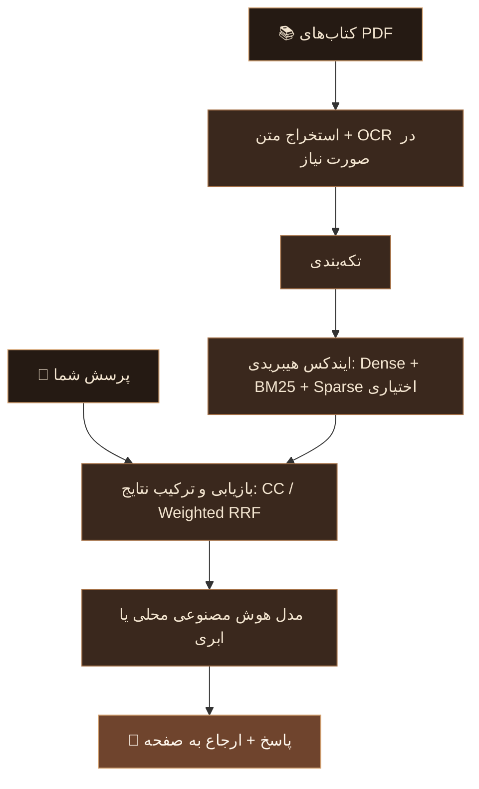
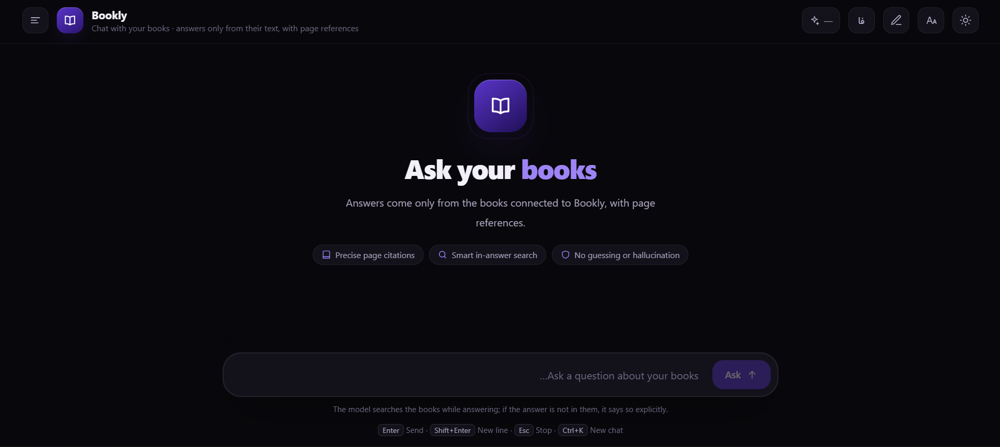
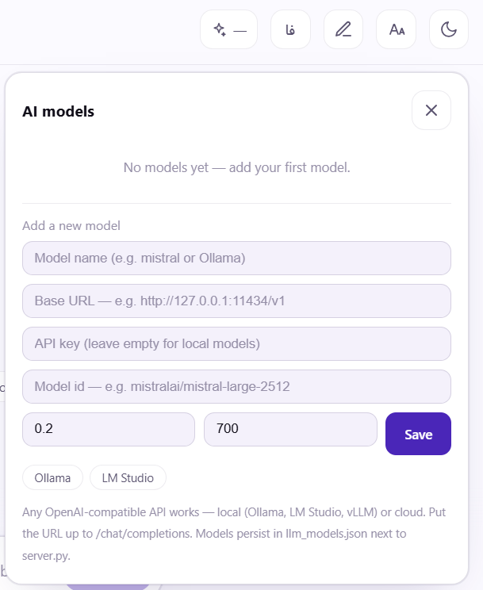

<div align="center">


<br/>

<a href="../README.md"></a>
<a href="https://www.python.org/"></a>
<a href="../LICENSE"></a>

<br/><br/>


### کتاب‌هایت را فقط نخوان؛ از آن‌ها بپرس.

**راهنمای فارسی Bookly**

گفت‌وگو با PDFهای فارسی و انگلیسی، همراه با ارجاع به صفحات منبع.<br/>
کتابخانه و جست‌وجو روی دستگاه خودت؛ مدل محلی یا ابری، به انتخاب خودت.

<br/>

[شروع سریع](#quick-start) · [اتصال مدل](#models) · [تنظیمات](#configuration) · [حریم خصوصی](#privacy) · [رفع اشکال](#troubleshooting)

<br/>

<a href="../README.md"><strong>Read the English README →</strong></a>

</div>

---

<div align="center">

## ◈ بوکلی در یک نگاه

**Bookly** یک دستیار RAG محلی و خودمیزبان برای کتاب‌های PDF خود شماست.<br/>
متن را استخراج می‌کند، در صورت نیاز OCR انجام می‌دهد و با جست‌وجوی هیبریدی، بخش‌های مرتبط را برای پاسخ‌گویی مدل پیدا می‌کند.

</div>

<br/>

<table>
<tr>
<td align="center" width="270">
<h3>📚 کتابخانهٔ خودت</h3>
PDFهای فارسی و انگلیسی، پوشه‌های دلخواه و پردازش افزایشی کتاب‌ها.
</td>
<td align="center" width="270">
<h3>🔎 جست‌وجوی ترکیبی</h3>
بازیابی معنایی و واژه‌ای، با ترکیب قابل تنظیم و sparse اختیاری.
</td>
<td align="center" width="270">
<h3>📖 پاسخ قابل پیگیری</h3>
گفت‌وگوی جریانی با منبع شماره‌دار و ارجاع به صفحهٔ کتاب.
</td>
</tr>
</table>

<br/>

> **پاسخ از کتاب، نه صرفاً از حافظهٔ مدل.**
>
> Bookly برای پاسخ‌گویی بر اساس متن بازیابی‌شده و اعلام نبود اطلاعات در کتاب‌ها طراحی شده است. با این حال، هیچ مدل زبانی کاملاً بی‌خطا نیست؛ پاسخ‌های مهم را با صفحات ارجاع‌شده تطبیق دهید.

---

<div align="center">

## ◈ از صفحه تا پاسخ

</div>



---

<div align="center">

## ◈ امکانات اصلی

*کمتر دنبال صفحه بگرد؛ بیشتر روی معنا تمرکز کن.*

</div>

| قابلیت | در Bookly چه می‌کند؟ |
|:---|:---|
| **رابط وب دوزبانه** | فارسی و انگلیسی، تم روشن و تاریک، تاریخچهٔ چت و نمایش جریانی پاسخ |
| **بازیابی هیبریدی** | Dense embeddings ⨁ BM25 ⨁ فهرست sparse اختیاری |
| **ترکیب قابل تنظیم** | Convex Combination یا RRF وزن‌دار |
| **ارجاع به صفحه** | منابع شماره‌دار مانند `[1]` همراه با عنوان کتاب و صفحه؛ قابل کلیک برای مراجعه به منبع |
| **پنل مدیریت مدل** | اتصال مدل سازگار با OpenAI بدون تغییر کد |
| **مدل محلی یا ابری** | Ollama، LM Studio، vLLM، OpenAI، OpenRouter و سرویس‌های سازگار |
| **پردازش فارسی** | نرمال‌سازی نیم‌فاصله و حروف عربی، توکن‌ساز فارسی BM25 |
| **پشتیبانی از اسکن** | OCR جایگزین برای صفحات نیازمند پردازش، همراه با کنترل کیفیت |
| **sync افزایشی** | تشخیص کتاب‌های جدید، تغییرکرده و حذف‌شده؛ ردکردن کتاب‌های بدون تغییر |
| **شروع بدون embedding** | ساخت ایندکس قابل جست‌وجوی واژه‌ای با `--no-embed` |
| **ادامهٔ پردازش M3** | checkpointing در backend نوع `m3` برای ادامه پس از توقف |
| **بازرتبه‌بندی اختیاری** | cross-encoder؛ به‌صورت پیش‌فرض خاموش و با توصیه به استفاده از GPU |
| **نسخهٔ ترمینال** | پرسش تک‌مرحله‌ای و محیط تعاملی با همان موتور |
| **نمونهٔ آماده** | یک کتاب کوچک و ایندکس واژه‌ای آماده برای امتحان رابط پیش از sync کتابخانه |

---

<div align="center">

## ◈ نگاهی به محیط برنامه

### کتابخانه‌ات، در قالب گفت‌وگو

</div>



<br/>

<div align="center">

### مدل را خودت انتخاب کن



</div>

---

<a id="quick-start"></a>

<div align="center">

## ◈ شروع سریع

**یک کتاب اضافه کن. ایندکس بساز. بپرس.**

</div>

### ۰۱ · پیش‌نیازها

- **Python 3.11+**؛ پروژه از `tomllib` استاندارد پایتون استفاده می‌کند.
- کتاب‌های PDF فارسی یا انگلیسی.
- **Tesseract OCR** فقط برای PDFهای اسکن‌شده؛ PDFهای دارای متن قابل انتخاب، OCR را رد می‌کنند.
- مدل محلی یا سرویس ابری برای تولید پاسخ گفت‌وگویی.

برای راه‌اندازی OCR:

1. Tesseract را نصب کنید. در ویندوز می‌توانید از [بیلدهای UB Mannheim](https://github.com/UB-Mannheim/tesseract/wiki) استفاده کنید.
2. فایل‌های `fas.traineddata` و `eng.traineddata` را از [tessdata_best](https://github.com/tesseract-ocr/tessdata_best) دریافت کنید.
3. فایل‌های زبان را در `app/tessdata/` بگذارید.
4. در صورت نیاز، مسیر Tesseract را در `booksearch.toml` تنظیم کنید.

### ۰۲ · دریافت پروژه و نصب

```bash
git clone https://github.com/Amin-Moniry/bookly.git
cd bookly
python -m venv .venv
```

**ویندوز — PowerShell**

```powershell
.\.venv\Scripts\Activate.ps1
python -m pip install -r requirements.txt
```

**لینوکس / macOS**

```bash
source .venv/bin/activate
python -m pip install -r requirements.txt
```

> دستورهای بعدی از **ریشهٔ پروژه** و با محیط مجازی فعال اجرا می‌شوند. در سیستمی که دستور Python با `python3` در دسترس است، همان را جایگزین کنید.

### ۰۳ · قرار دادن کتاب‌ها

PDFها را در `library/` بگذارید:

```text
library/
├── poetry-collection.pdf
├── ai-handbook.pdf
└── my-notes/
    └── another-book.pdf
```

نام فایل‌ها و زیرپوشه‌ها می‌تواند فارسی یا انگلیسی باشد. نام‌های بالا صرفاً نمونه‌اند.

### ۰۴ · ساخت ایندکس

```bash
python app/ingest.py sync
```

روند پردازش:

```text
extract → OCR if needed → chunk → embed → merge
```

ایندکس در `index/` ساخته می‌شود.

> **برای شروع سریع‌تر**
>
> ابتدا ایندکس واژه‌ای بسازید؛ embedding را بعداً اضافه کنید:

```bash
python app/ingest.py sync --no-embed
```

سپس برای افزودن لایهٔ معنایی:

```bash
python app/ingest.py sync --force embed
```

### ۰۵ · اجرای رابط وب

```bash
python app/server.py
```

در مرورگر باز کنید: **http://127.0.0.1:8765**

> **هنوز کتابی ایندکس نکرده‌اید؟**
>
> پروژه یک کتاب نمونه در `demo/sample-book.pdf` و ایندکس واژه‌ای آماده در `index/sample/` دارد. برنامه تا پیش از اولین sync واقعی از نمونه استفاده می‌کند و سپس به کتابخانهٔ شما تغییر می‌کند.

### ۰۶ · اتصال مدل و اولین پرسش

از دکمهٔ **✨ AI models** در هدر، مدل را اضافه و فعال کنید.

پرسش نمونه:

> خلاصهٔ فصل سوم چیه؟

یا:

> نویسنده در این کتاب چه دلایلی برای این موضوع آورده؟

پاسخ‌ها برای ارجاع به منابعی مانند `[n]` و صفحهٔ کتاب طراحی شده‌اند. اگر اطلاعات مرتبط پیدا نشود، برنامه باید نبود پاسخ در کتاب‌ها را اعلام کند؛ این رفتار را نیز مانند خود پاسخ، در استفاده‌های حساس بررسی کنید.

### ۰۷ · به‌روزرسانی کتابخانه

پس از افزودن، تغییر یا حذف کتاب‌ها، دوباره اجرا کنید:

```bash
python app/ingest.py sync
```

کتاب‌های بدون تغییر رد می‌شوند؛ فقط موارد نیازمند پردازش دوباره بررسی می‌شوند.

---

<a id="models"></a>

<div align="center">

## ◈ اتصال مدل هوش مصنوعی

*محلی برای کنترل بیشتر؛ ابری برای انتخاب گسترده‌تر.*

</div>

برنامه را باز کنید و روی **✨ AI models** بزنید:

| فیلد | نمونهٔ محلی | نمونهٔ ابری |
|:---|:---|:---|
| **Base URL** | Ollama: `http://127.0.0.1:11434/v1`<br/>LM Studio: `http://127.0.0.1:1234/v1` | `https://api.openai.com/v1` یا میزبان سازگار دیگر |
| **API Key** | در تنظیمات معمول محلی خالی؛ وابسته به سرور | کلید سرویس‌دهندهٔ خودتان |
| **Model ID** | `mistral` یا `qwen2.5:7b`، در صورت نصب | مثلاً `gpt-4o-mini`، در صورت ارائه توسط سرویس |

روی مدل کلیک کنید تا فعال شود. نام مدل فعال در هدر دیده می‌شود.

- **Ollama / LM Studio / vLLM** برای endpointهای محلی قابل استفاده‌اند.
- **OpenAI / OpenRouter / میزبان‌های سازگار** برای اتصال ابری قابل استفاده‌اند.
- شناسهٔ مدل باید با مدل نصب‌شده یا مدل ارائه‌شده توسط سرویس مطابقت داشته باشد.
- سرور محلی مدل باید پیش از تست اتصال در حال اجرا باشد.
- Base URL را بدون پسوند `/chat/completions` وارد کنید.

> Bookly به یک مدل مشخص مانند Qwen یا Mistral محدود نیست. مدل چت را از پنل انتخاب می‌کنید؛ backend جست‌وجو و embedding، تنظیم جداگانه‌ای دارد.

---

<div align="center">

## ◈ نسخهٔ ترمینال

*همان موتور، بدون مرورگر.*

</div>

پرسش تک‌مرحله‌ای:

```bash
python app/booker.py "یک سؤال دربارهٔ کتاب‌هات"
```

حالت تعاملی:

```bash
python app/booker.py
```

پیش‌فرض‌های چت ترمینال در بخش `[llm]` فایل تنظیمات قرار دارند.

---

<a id="configuration"></a>

<div align="center">

## ◈ تنظیمات

</div>

تنظیمات اصلی در **[`booksearch.toml`](../booksearch.toml)** قرار دارند؛ توضیحات آن فارسی و انگلیسی‌اند.

| بخش | چه چیزی را کنترل می‌کند؟ |
|:---|:---|
| `[paths]` | مسیر `library/` و `index/` |
| `[extract]` | موتور OCR، DPI، workerهای موازی و کنترل کیفیت صفحات اسکن‌شده |
| `[chunk]` | اندازهٔ تکه، هم‌پوشانی جمله‌ها و سربرگ بخش‌ها |
| `[embed]` | backend پیش‌فرض `st` یا گزینهٔ `m3` برای کیفیت بالاتر |
| `[search]` | fusion با `cc` یا `rrf`، عمق جست‌وجو، آستانه‌ها و تکه‌های همسایه |
| `[rerank]` | cross-encoder اختیاری؛ خاموش به‌صورت پیش‌فرض، GPU توصیه می‌شود |
| `[llm]` | پیش‌فرض‌های مدل در چت ترمینال |

> **کلید واقعی API را در این فایل ننویسید.**
>
> کلیدهای اضافه‌شده از پنل مدل در `app/llm_models.json` ذخیره می‌شوند؛ این فایل برای انتشار در Git نیست.

### یادداشت فنی: سه انتخاب مستقل

| انتخاب | نقش |
|:---|:---|
| **مدل چت** | تولید پاسخ از متن بازیابی‌شده؛ از پنل مدل انتخاب می‌شود |
| **backend ایندکس** | روش پردازش embedding؛ از بخش `[embed]` تنظیم می‌شود |
| **روش fusion** | ترکیب فهرست‌های بازیابی؛ از بخش `[search]` تنظیم می‌شود |

`st` و `m3` نام backend هستند، نه نام مدل چت. همچنین `rrf` تنها گزینهٔ ترکیب نیست؛ مقدار فعال را در تنظیمات نسخهٔ خودتان بررسی کنید.

---

<div align="center">

## ◈ کتاب‌ها چقدر زود آماده می‌شوند؟

*برآورد واقعی‌نگرانه؛ نه وعدهٔ سرعت ثابت.*

</div>

زمان‌های تقریبی برای **یک PDF حدود ۳۰۰ صفحه‌ای روی CPU لپ‌تاپ معمولی، بدون GPU**:

| حالت | PDF عمدتاً متنی | PDF اسکن‌شده با OCR |
|:---|:---:|:---:|
| **اولین ایندکس با `st` — پیش‌فرض** | حدود ۵ تا ۱۵ دقیقه | حدود ۱۵ تا ۴۵ دقیقه |
| **اولین ایندکس با `m3` — گزینهٔ کیفیت بالاتر** | حدود ۱ تا ۳ ساعت | حدود ۳ تا ۶ ساعت |
| **sync مجدد** | بدون تغییر معمولاً چند ثانیه؛ در صورت تغییر، پردازش همان کتاب‌ها | فقط کتاب‌های تغییرکرده پردازش می‌شوند |

- استخراج متن ساده در README پروژه حدود **۱ میلی‌ثانیه برای هر صفحه** برآورد شده است.
- برای OCR حدود **۱ تا ۳ ثانیه برای هر صفحه** ذکر شده؛ اسکن معمولاً بخش کندتر است.
- با `--no-embed` می‌توان برای ورودی مناسب، ایندکس متنی را در کمتر از یک دقیقه ساخت.
- backend نوع `m3` از **checkpointing** پشتیبانی می‌کند؛ اجرای دوباره می‌تواند پردازش قطع‌شده را ادامه دهد.
- لازم نیست از همهٔ کتابخانه شروع کنید؛ ابتدا یک کتاب را ایندکس و امتحان کنید.

> زمان واقعی به سخت‌افزار، تعداد صفحات، کیفیت اسکن و تنظیمات بستگی دارد. این اعداد برای کل کتابخانه یا هر نوع PDF تضمین نمی‌شوند و زمان تولید پاسخ مدل را نشان نمی‌دهند.

---

<div align="center">

## ◈ فارسی و انگلیسی

</div>

| لایه | پشتیبانی |
|:---|:---|
| **رابط کاربری** | انگلیسی و فارسی، همراه با تم روشن و تاریک |
| **متن فارسی** | نرمال‌سازی نیم‌فاصله و حروف عربی |
| **جست‌وجوی واژه‌ای** | توکن‌ساز فارسی BM25 |
| **کتاب‌های اسکن‌شده** | OCR با داده‌های زبان `fas` و `eng` |
| **فایل‌ها و پوشه‌ها** | نام‌های فارسی یا انگلیسی و زیرپوشه‌های دلخواه |

کیفیت OCR به کیفیت اسکن و دادهٔ زبان بستگی دارد. اگر جست‌وجوی یک کتاب اسکن‌شده ضعیف است، ابتدا متن استخراج‌شده را بررسی کنید.

---

<a id="privacy"></a>

<div align="center">

## ◈ حریم خصوصی و مرز داده‌ها

**محلی‌بودن کتابخانه به معنی محلی‌بودن همهٔ مدل‌ها نیست.**

</div>

### چه چیزهایی روی دستگاه شما هستند؟

- PDFها و ایندکس جست‌وجو.
- استخراج، OCR، تکه‌بندی و بازیابی.
- کلیدهای پنل مدل در `app/llm_models.json`.
- تاریخچهٔ چت در `localStorage` مرورگر شما.

### اگر مدل ابری انتخاب کنید

پرسش و بخش‌های مرتبط کتاب برای تولید پاسخ ممکن است به endpoint انتخابی ارسال شوند. پردازش و نگهداری آن داده تابع سیاست‌های همان سرویس است.

برای inference روی دستگاه خودتان، از سرور مدل محلی استفاده کنید.

### چه چیزهایی نباید در مخزن منتشر شوند؟

| مسیر | محتوا |
|:---|:---|
| `library/` | PDFهای شخصی شما |
| `index/` | ایندکس اصلی کتابخانه؛ `index/sample/` نمونهٔ آماده و استثنای عمدی است |
| `app/llm_models.json` | تنظیمات مدل و کلیدهای API |
| `eval/questions.jsonl` | پرسش‌های ارزیابی خصوصی که ممکن است از کتاب‌ها نقل‌قول کنند |
| `eval/results.jsonl` | نتایج ارزیابی خصوصی |
| فایل‌های دادهٔ OCR | فایل‌های زبان دانلودشده؛ از جمله داده‌های مورد استفاده در `app/tessdata/` |

نمونهٔ قابل انتشار قالب ارزیابی: [`eval/questions.sample.jsonl`](../eval/questions.sample.jsonl).

> **قبل از انتشار مخزن**
>
> `git status` و تغییرات staged را بررسی کنید. `.gitignore` از ثبت خودکار فایل جدید جلوگیری می‌کند؛ فایل از قبل trackشده را از Git یا تاریخچه حذف نمی‌کند. کلیدها، کتاب‌ها و داده‌های شخصی را دستی هم بازبینی کنید.

---

<div align="center">

## ◈ تست‌ها

</div>

```bash
python -m pytest tests -q
```

در README جدید پروژه، **۴۴ تست** برای این حوزه‌ها ذکر شده است:

| حوزه | پوشش |
|:---|:---|
| **پردازش متن** | نرمال‌سازی و tokenizer |
| **بازیابی** | ترکیب نتایج با RRF |
| **پایداری ایندکس** | پایداری شناسهٔ تکه‌ها |
| **sync افزایشی** | افزودن، تغییر نام، ویرایش و حذف |
| **ارزیابی** | ابزار ارزیابی retrieval |
| **ترمینال** | رفتار CLI |

تعداد و نتیجهٔ فعلی تست‌ها را با اجرای دستور بالا در نسخهٔ نصب‌شده بررسی کنید؛ عدد تست به معنی تضمین کیفیت پاسخ مدل نیست.

---

<a id="troubleshooting"></a>

<div align="center">

## ◈ رفع اشکال

</div>

| نشانه | بررسی پیشنهادی |
|:---|:---|
| **برای همهٔ سؤال‌ها پاسخ پیدا نمی‌شود** | وجود PDF در `library/` را بررسی و `python app/ingest.py sync` را اجرا کنید |
| **متن PDF اسکن‌شده نامفهوم است** | نصب Tesseract، فایل‌های `fas` و `eng` در `app/tessdata/` و تنظیمات OCR را بررسی کنید؛ `tesseract` موتور پیش‌فرض است |
| **چت پیام Server unreachable می‌دهد** | سرور را با `python app/server.py` اجرا کنید |
| **embedding روی CPU کند است** | backend را روی `st` نگه دارید؛ `m3` را برای نیازهای حساس به کیفیت انتخاب کنید |
| **تست مدل ناموفق است** | Base URL باید قبل از `/chat/completions` تمام شود؛ شناسهٔ مدل و کلید سرویس ابری را هم بررسی کنید |
| **نیاز به ایندکس تازه دارید** | داده‌های لازم را پشتیبان بگیرید، ایندکس تولیدشده را حذف و sync را دوباره اجرا کنید |

### دو نکتهٔ مهم

- **OCR لازم نیست روی همهٔ PDFها اجرا شود.** کتاب دارای لایهٔ متن سالم می‌تواند مرحلهٔ OCR را رد کند.
- **مراجعه به صفحه همچنان مهم است.** ارجاع، راه بررسی پاسخ است؛ تضمین درستی خودکار پاسخ نیست.

---

<div align="center">

## ◈ ساختار مخزن

</div>

```text
bookly/
├── README.md                # English guide
├── booksearch.toml          # Main configuration
├── requirements.txt         # Python dependencies
│
├── app/                     # Server, search, ingest, chat, evaluation
│   ├── server.py            # Local web server
│   ├── ingest.py            # Library indexing and sync
│   ├── booker.py            # Terminal chat
│   ├── web/
│   │   └── index.html       # Single-file frontend; no build step
│   ├── tessdata/            # Downloaded OCR language data
│   └── llm_models.json      # Local model settings and keys; git-ignored
│
├── static/
│   ├── main.png             # Chat screenshot
│   └── Ai-Part.png          # Model-panel screenshot
│
├── demo/
│   ├── sample-book.pdf      # Small demo book
│   └── make_sample_book.py  # Demo generator
│
├── library/                 # Your PDFs; git-ignored
├── index/                   # Generated library index
│   └── sample/              # Bundled demo keyword index
│
├── eval/                    # Evaluation data
│   └── questions.sample.jsonl
├── tests/                   # Pytest suite
├── docs/
│   └── dev-notes.md         # Persian guide — this file
└── LICENSE                  # MIT
```

> این درخت، مسیرهای اصلی توضیح‌داده‌شده در راهنمای پروژه را نشان می‌دهد؛ فهرست کامل همهٔ فایل‌های برنامه نیست.

---

<div align="center">

## ◈ پرسش‌های متداول

</div>

| سؤال | پاسخ |
|:---|:---|
| **بدون GPU هم کار می‌کند؟** | بله؛ backend پیش‌فرض `st` نقطهٔ شروع سریع‌تر است. نیاز مدل چت محلی به مدل انتخابی بستگی دارد. |
| **حتماً به API ابری نیاز دارم؟** | خیر؛ می‌توانید مدل محلی سازگار با OpenAI متصل کنید. |
| **بدون embedding می‌توانم شروع کنم؟** | بله؛ `sync --no-embed` ایندکس قابل جست‌وجوی واژه‌ای می‌سازد. |
| **PDF فارسی اسکن‌شده پشتیبانی می‌شود؟** | بله؛ با Tesseract و دادهٔ زبان فارسی، با کیفیت وابسته به اسکن. |
| **با افزودن کتاب باید همه چیز را از اول بسازم؟** | خیر؛ sync افزایشی کتاب‌های بدون تغییر را رد می‌کند. |
| **قبل از ایندکس کتاب‌ها می‌توانم برنامه را ببینم؟** | بله؛ کتاب و ایندکس نمونه در مخزن وجود دارد. |
| **پاسخ‌ها حتماً درست‌اند؟** | خیر؛ هدف، پاسخ مستند به کتاب است، اما بررسی صفحات برای ادعاهای مهم ضروری است. |
| **تاریخچهٔ چت کجاست؟** | در `localStorage` مرورگر روی دستگاه شما. |
| **فرانت‌اند به build نیاز دارد؟** | خیر؛ رابط در `app/web/index.html` قرار دارد. |
| **نسخهٔ انگلیسی راهنما کجاست؟** | در [README اصلی مخزن](../README.md). |

---

<div align="center">

## ◈ سازنده


<br/>

<a href="https://github.com/Amin-Moniry"></a>
<a href="https://github.com/Amin-Moniry/bookly"></a>
<a href="https://github.com/Amin-Moniry/bookly/issues"></a>

<br/><br/>

**اگر Bookly به کشف کتابخانه‌ات کمک کرد، با یک ستاره از آن حمایت کن.**

</div>

---

<div align="center">

## ◈ مجوز

منتشرشده تحت **MIT License** — متن کامل در [LICENSE](../LICENSE).

<br/>

**کتابخانهٔ خودت. مدل خودت. با سرعت خودت.**

<br/>

[English README](../README.md) · [شروع سریع](#quick-start) · [GitHub](https://github.com/Amin-Moniry/bookly)

<br/>


</div>
